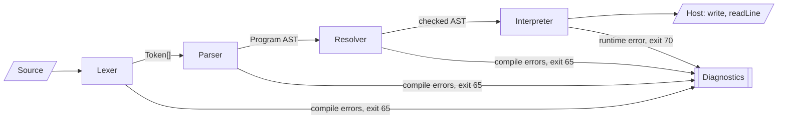
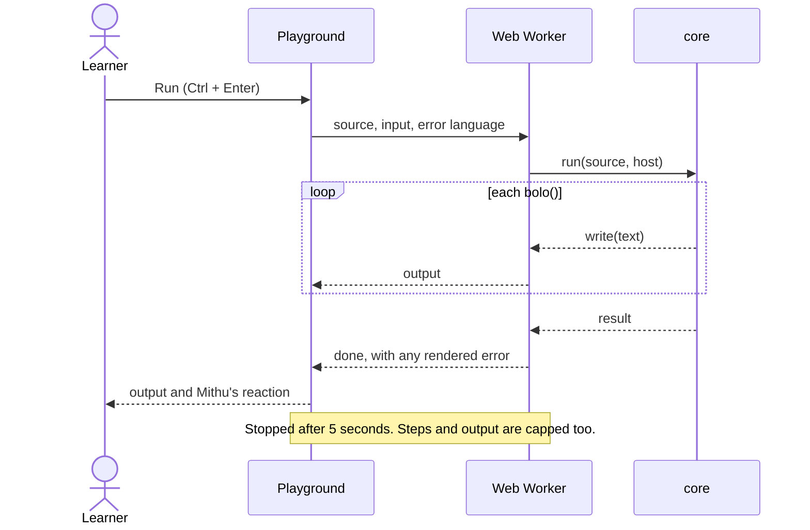
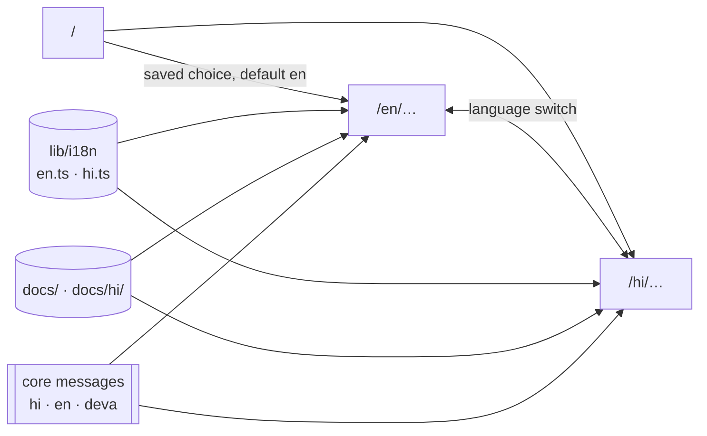

<div align="center">


# Jugaad Hinglish

**Code likho, apni bhasha mein.**

A small programming language with Roman-script Hindi keywords, with a command line,
a browser playground and a website in English and Hindi.


</div>

## Team Name

AI (Aimless Insomniacs)

## Track Number & Name

Track 3: Tiny Languages and Playgrounds

## Problem Statement Name

Compile Me Maybe

## Idea

Jugaad Hinglish is a small, dynamically typed, lexically scoped language that uses
Hindi keywords written in English letters, such as `rakho` (variable), `agar` (if)
and `kaam` (function). It aims to make first steps in programming easier for people
who think in Hinglish, so they can focus on logic using familiar words.

```text
kaam factorial(n) { agar (n <= 1) { wapas 1; } wapas n * factorial(n-1); }
bolo(factorial(5));   // 120
```

The name, the `.hing` extension, the `hinglish` command and the keyword spellings
are placeholders and may still change.

## Features

| Area | What you get |
| --- | --- |
| Language | Variables, constants, conditions, loops, functions and closures, lists, dictionaries |
| Errors | A code, line, column and caret, a "did you mean" hint, and Hinglish, English or Devanagari text |
| Command line | `run`, `check` and a REPL |
| Playground | Runs in the browser, with highlighting, suggestions, examples and share links |
| Website | Getting started, tour, cheatsheet, reference, error codes and search |
| Two languages | The whole website in English (`/en`) or Hindi (`/hi`) |
| Mithu | A parrot that reacts to your runs, gives tips and makes sounds (can be muted) |

## High-level design


Dependencies point one way: `apps` and `cli` import `core`, and `core` imports
nothing outside itself. ESLint enforces this rule.

### Interpreter pipeline



| Stage | Job | Error codes |
| --- | --- | --- |
| Lexer | Hand-written, linear-time scanner; keywords come from one language pack | `E01xx` |
| Parser | Recursive descent with recovery, up to 20 diagnostics | `E02xx` |
| Resolver | Scopes, undefined and duplicate names, constants, arity | `E03xx` |
| Interpreter | Tree walking, closures, call-depth limit of 1000 and an optional step budget | `E04xx` |

### A playground run



Programs run on your own device. Your code is not sent to a server.

### Website languages



There is no i18n library: the type of the English dictionary makes a missing Hindi
entry a compile error. Keywords, built-ins and names stay in Roman script in both
languages. See [ADR 0005](docs/decisions/0005-site-i18n.md).

## The language at a glance

| Concept | Keyword |
| --- | --- |
| variable / constant | `rakho` / `pakka` |
| function / return | `kaam` / `wapas` |
| if / else | `agar` / `warna` |
| true / false / null | `sach` / `jhooth` / `khaali` |
| while / counted loop | `jabtak` / `chalo` |
| break / continue | `ruko` / `agla` |
| and / or / not | `aur` / `ya` / `nahi` |

Built-in functions: `bolo`, `suno`, `lambai`, `joro`, `nikalo`, `sankhya`, `shabd`
and `prakar`. The full rules are in the
[language specification](docs/language-spec.md)
([हिन्दी](docs/hi/language-spec.md)).

### Errors that explain themselves

```text
rakho total = 10;
bolo(totl);
```

```text
Galti E0301 [naam nahi mila] at demo.hing:2:6
    bolo(totl);
         ^^^^
'totl' declare nahi hua (undefined variable 'totl')
kya aapka matlab 'total' tha? (did you mean 'total'?)
```

All codes are listed in [error codes](docs/error-codes.md)
([हिन्दी](docs/hi/error-codes.md)).

## How to Run

### Prerequisites

- Node.js 24 or newer (includes npm)
- Git

### Installation

```sh
git clone https://github.com/KarthikSP1911/Jugaad-Lab.git
cd Jugaad-Lab
npm ci
npm run build
```

### Run a program

```sh
node packages/cli/dist/main.js run examples/hello.hing
node packages/cli/dist/main.js run examples/fizzbuzz.hing
node packages/cli/dist/main.js check examples/hisaab.hing --lang=en
```

`--lang` accepts `en` or `hi`. Without it, errors show Hinglish with English in
brackets.

### Start the interactive prompt (type `.exit` to quit)

```sh
node packages/cli/dist/main.js repl
```

### Start the documentation site and playground

```sh
npm run dev -w @jugaad-hinglish/docs
```

Then open <http://localhost:3000>. It takes you to `/en` or `/hi`; the header has a
language switch and a button that mutes Mithu.

`npm run build` also exports the site as static files to `apps/docs/out`.

### Run the checks

```sh
npm run typecheck
npm run lint
npm test
```

## Project layout

```text
packages/core/     lexer, parser, resolver, interpreter, diagnostics
packages/cli/      hinglish command and REPL
apps/docs/         website and playground (Next.js)
tests/programs/    golden programs (.hing with expected output)
examples/          sample programs
docs/              specification, error codes, decisions; Hindi copies in docs/hi/
tools/             sample migration and benchmark scripts
```

## More documentation

- [Architecture](docs/architecture.md)
- [Decision records](docs/decisions/)
- [Intentional changes from KannadaScript](docs/intentional-changes.md)
- [Baseline timings](docs/baseline-timings.md)
- [Progress](docs/progress.md) and [changelog](CHANGELOG.md)
- [Third-party notices](NOTICE)
