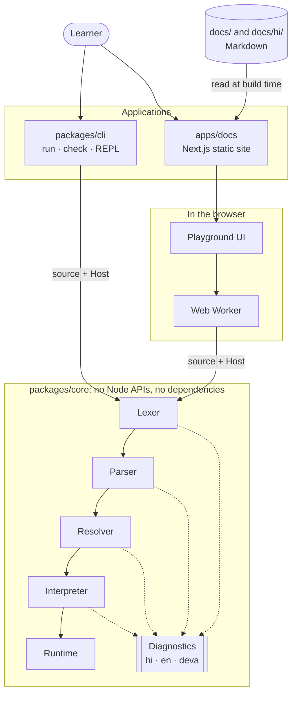
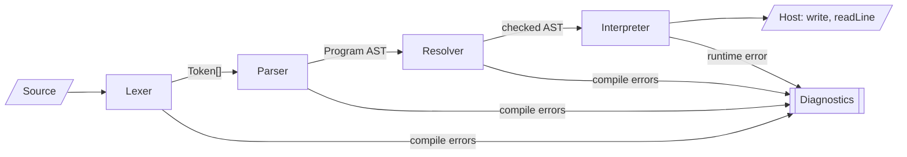
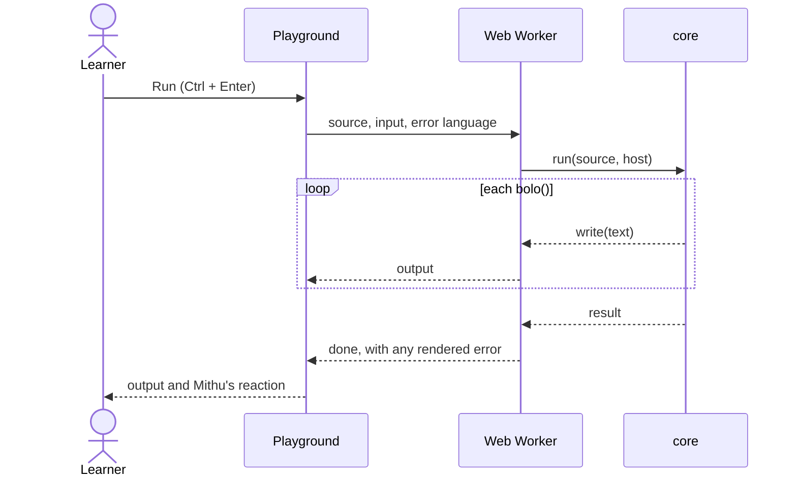
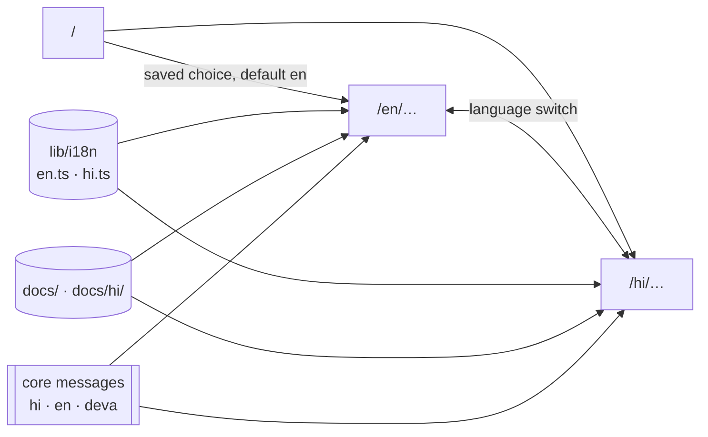

<div align="center">


# Jugaad Hinglish

**A small programming language with Roman-script Hindi keywords.**

[](https://github.com/KarthikSP1911/Jugaad-Lab/actions/workflows/ci.yml)


[Quick start](#quick-start) ·
[Language](#language-guide) ·
[Architecture](#architecture) ·
[Development](#development) ·
[Documentation](#documentation)

</div>

---

## Table of contents

- [Overview](#overview)
- [Features](#features)
- [Quick start](#quick-start)
- [Command line](#command-line)
- [Language guide](#language-guide)
- [Architecture](#architecture)
- [Project structure](#project-structure)
- [Development](#development)
- [Roadmap](#roadmap)
- [Contributing](#contributing)
- [Documentation](#documentation)
- [Acknowledgements](#acknowledgements)
- [License](#license)

## Overview

Jugaad Hinglish is a dynamically typed, lexically scoped language implemented as a
tree-walking interpreter in TypeScript. Its keywords are Hindi words written in
English letters, so beginners who think in Hinglish can focus on logic using
familiar words.

```text
kaam factorial(n) {
    agar (n <= 1) { wapas 1; }
    wapas n * factorial(n - 1);
}

bolo(factorial(5));   // 120
```

The same interpreter runs on the command line and in the browser.

> **Status:** version 0.1.0, not yet released. The name, the `.hing` extension, the
> `hinglish` command and the keyword spellings may still change.

## Features

| Area | What you get |
| --- | --- |
| **Language** | Variables, constants, conditions, loops, functions, closures, lists and dictionaries |
| **Diagnostics** | Error code, line, column, caret and "did you mean" hints, in Hinglish, English or Devanagari |
| **Static checks** | Undefined and duplicate names, constant reassignment and wrong argument counts are caught before the program runs |
| **Command line** | `run`, `check` and an interactive REPL |
| **Playground** | Runs in the browser, with highlighting, suggestions, examples and share links |
| **Website** | Getting started, language tour, cheatsheet, reference, error codes and search |
| **Localisation** | The whole website in English (`/en`) and Hindi (`/hi`) |
| **Mithu** | A parrot mascot that reacts to program runs and gives tips, with sound that can be muted |

## Quick start

### Prerequisites

- [Node.js](https://nodejs.org) 24 or newer (includes npm)
- [Git](https://git-scm.com)

### Install and build

```sh
git clone https://github.com/KarthikSP1911/Jugaad-Lab.git
cd Jugaad-Lab
npm ci
npm run build
```

### Run your first program

```sh
node packages/cli/dist/main.js run examples/hello.hing
```

```text
Namaste, duniya!
```

### Start the website and playground

```sh
npm run dev -w @jugaad-hinglish/docs
```

Open <http://localhost:3000>. It takes you to `/en` or `/hi`, and the header has a
language switch. `npm run build` exports the site as static files to
`apps/docs/out`.

## Command line

```sh
node packages/cli/dist/main.js <command> [file] [--lang=en|hi]
```

| Command | Description |
| --- | --- |
| `run <file>` | Check and run a program |
| `check <file>` | Report errors without running |
| `repl` (default) | Start the interactive prompt; type `.exit` to quit |
| `--help`, `-h` | Show usage |
| `--version`, `-v` | Show the version |

`--lang` selects English or Hinglish messages. Without it, errors show Hinglish with
English in brackets.

| Exit code | Meaning |
| --- | --- |
| `0` | Success |
| `64` | Incorrect usage |
| `65` | Compile errors |
| `66` | The file could not be read |
| `70` | Runtime error |

## Language guide

### Keywords

| Concept | Keyword |
| --- | --- |
| Variable / constant | `rakho` / `pakka` |
| Function / return | `kaam` / `wapas` |
| If / else | `agar` / `warna` |
| True / false / null | `sach` / `jhooth` / `khaali` |
| While / counted loop | `jabtak` / `chalo` |
| Break / continue | `ruko` / `agla` |
| And / or / not | `aur` / `ya` / `nahi` |

### Built-in functions

| Function | Description |
| --- | --- |
| `bolo(a, b, ...)` | Print values, then a new line |
| `suno(prompt)` | Show a prompt and read one line |
| `lambai(x)` | Length of a string, list or dictionary |
| `joro(list, x)` | Add `x` to the end of a list |
| `nikalo(list)` | Remove and return the last element |
| `sankhya(x)` | Convert a string to a number |
| `shabd(x)` | Convert any value to a string |
| `prakar(x)` | Name of the type of `x` |

### Example

```text
rakho marks = [82, 91, 68];
rakho jod = 0;

chalo (rakho i = 0; i < lambai(marks); i += 1) {
    jod += marks[i];
}

agar (jod / lambai(marks) >= 75) {
    bolo("Shabash!");
} warna {
    bolo("Aur mehnat karo.");
}
```

### Error messages

```text
rakho total = 10;
bolo(totl);
```

```text
Galti E0301 [naam nahi mila] at demo.hing:2:6
    bolo(totl);
         ^^^^
'totl' declare nahi hua (undefined variable 'totl')
kya aapka matlab 'total' tha? (did you mean 'total'?)
```

See the full [language specification](docs/language-spec.md) and
[error code reference](docs/error-codes.md).

## Architecture

### High-level design



Design principles:

- **One-way dependencies.** `apps` and `cli` import `core`; `core` imports nothing
  outside itself. ESLint enforces this.
- **Injected I/O.** The interpreter reads and writes only through a synchronous
  `Host`, so it behaves the same in Node and the browser.
- **No global state.** Every run creates its own objects.

### Interpreter pipeline



| Stage | Responsibility | Error codes |
| --- | --- | --- |
| Lexer | Hand-written, linear-time scanner; keywords come from one language pack | `E01xx` |
| Parser | Recursive descent with error recovery, up to 20 diagnostics | `E02xx` |
| Resolver | Scopes, name checks, constants and argument counts | `E03xx` |
| Interpreter | Tree walking, closures, call-depth limit of 1000 and an optional step budget | `E04xx` |

### Playground execution



Programs run on the learner's own device and are not sent to a server. A run is
limited to 5 seconds, 5,000,000 steps and 100,000 characters of output.

### Localisation



The type of the English dictionary makes a missing Hindi entry a compile error, so
no i18n library is needed. Keywords, built-ins and identifiers stay in Roman script.
See [ADR 0005](docs/decisions/0005-site-i18n.md).

## Project structure

```text
.
├── packages/
│   ├── core/          lexer, parser, resolver, interpreter, diagnostics
│   └── cli/           hinglish command and REPL
├── apps/
│   └── docs/          website and playground (Next.js)
├── tests/programs/    golden programs with expected output
├── examples/          sample programs
├── docs/              specification, error codes, decisions (Hindi in docs/hi/)
└── tools/             sample migration and benchmark scripts
```

## Development

| Command | Description |
| --- | --- |
| `npm run typecheck` | Type-check all workspaces |
| `npm run lint` | Run ESLint |
| `npm test` | Run all tests |
| `npm run test:programs` | Run the golden programs only |
| `npm run build` | Build the packages and the website |

Continuous integration runs the type check, lint, tests and build on every pull
request and on pushes to `main`.

## Roadmap

Planned for consideration after 0.1, with no committed dates:

- Modules and classes
- For-each loops and `try` / `catch`
- String interpolation and an integer type
- A standard library
- Devanagari keywords
- A bytecode virtual machine and a language server

## Contributing

1. Create a short-lived branch from `main`, such as `feat/lexer` or
   `fix/negative-numbers`.
2. Add a unit test for every new behaviour, and a golden program if users can see it.
3. Update the [specification](docs/language-spec.md) when the language changes, and
   add the Hindi counterpart for new messages, pages and documentation.
4. Make sure `npm run typecheck`, `npm run lint` and `npm test` pass.
5. Write commits in [Conventional Commits](https://www.conventionalcommits.org) form,
   for example `fix(parser): accept minus without space`.
6. Open a pull request.

## Documentation

| Document | Contents |
| --- | --- |
| [Language specification](docs/language-spec.md) ([हिन्दी](docs/hi/language-spec.md)) | Syntax, types, semantics and grammar |
| [Error codes](docs/error-codes.md) ([हिन्दी](docs/hi/error-codes.md)) | Every diagnostic code |
| [Architecture](docs/architecture.md) | Packages and dependency rules |
| [Decision records](docs/decisions/) | Why the project is built this way |
| [Intentional changes](docs/intentional-changes.md) | Differences from KannadaScript |
| [Baseline timings](docs/baseline-timings.md) | Performance reference |
| [Changelog](CHANGELOG.md) | Release notes |

## Acknowledgements

The design draws on an audit of KannadaScript. The interpreter is written from its
own specification, and translated KannadaScript test programs are used under the MIT
License. Fonts and other third-party material are listed in [NOTICE](NOTICE).

## License

No licence has been chosen for this project yet, so no permission to reuse the code
is granted. Third-party material keeps its own licence; see [NOTICE](NOTICE).
